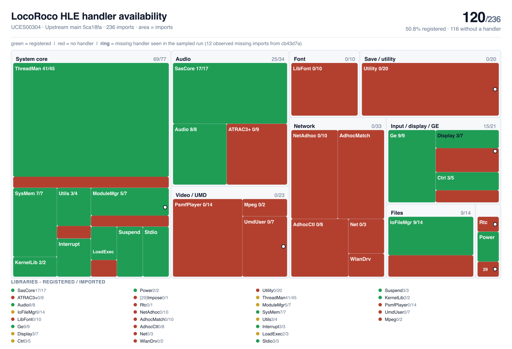

# PSP firmware HLE availability

Measured firmware entry-point coverage for **LocoRoco (UCES00304)** using
[sp00nznet/psprecomp](https://github.com/sp00nznet/psprecomp).

<picture>
  <source media="(prefers-color-scheme: dark)" srcset="docs/progress/hle-coverage-dark.394d55b25600.png">
  
</picture>

<sub>[Light vector](docs/progress/hle-coverage.svg) | [Dark vector](docs/progress/hle-coverage-dark.svg) | Regenerate with `tools/update.sh`</sub>

## What this measures

**A registered handler is not a fully implemented PSP service.** This is a count
of the game's imported NIDs found in the runtime dispatch registry. Minimal
handlers and no-op placeholders count too. It does not measure gameplay
completion, firmware fidelity, rendering accuracy, working audio or frame rate.
The goal is to locate missing entry points, not claim a percentage of the game
has been ported.

| Snapshot | Registered / imported | Availability | Without a handler |
|---|---:|---:|---:|
| Upstream main (`5ca18fa`) | 120/236 | 50.8% | 116 |
| Local integration (pending PRs) (`cb43d7a`) | 122/236 | 51.7% | 114 |

The picture uses the **upstream main snapshot**, pinned to
[`5ca18fa`](https://github.com/sp00nznet/psprecomp/commit/5ca18fac1691a4a7b40ae683dabdf72a5703d2b8).
The local integration is a separate experimental snapshot with unmerged work;
it is not presented as functionality already available on upstream main.
The older README's 117 and data snapshot's 135 were inconsistent. Both have
been replaced by fresh registry measurements with explicit source revisions;
those older figures are not the current upstream baseline.

## Reading the picture

- **Green:** imported NID has a registered handler.
- **Red:** no registered handler.
- **Ring:** a missing handler observed in the sampled native-run log.
- Areas are weighted by imports at the family level and within each family.

The log identifies **12 distinct missing imported entry points** from
local integration `cb43d7a`, not an upstream-only gameplay run.
Logging is rate-limited and the final busiest-call list is truncated, so this
is a lower bound, not complete reachability analysis. A ring does not establish
that a function causes the current menu-transition problem.

| Family | Upstream registered | Local registered | Imported |
|---|---:|---:|---:|
| System core | 69 | 69 | 77 |
| Audio | 25 | 25 | 34 |
| Network | 0 | 0 | 33 |
| Video / UMD | 0 | 0 | 23 |
| Input / display / GE | 15 | 16 | 21 |
| Save / utility | 0 | 0 | 20 |
| Files | 9 | 10 | 14 |
| Font | 0 | 0 | 10 |
| Misc | 2 | 2 | 4 |

Named missing lists: [upstream](docs/progress/hle-missing.md) and
[local integration](docs/progress/hle-missing-locoroco-bringup.md).

## What the pending integration adds

Additional imported handlers in the local registry:

- `sceCtrlReadLatch` (`0x0B588501`, `sceCtrl`).
- `sceIoGetstat` (`0xACE946E8`, `IoFileMgrForUser`).

`PeekLatch` is also registered locally, but is not imported by this module, so
it does not increase this metric. Emitter and stack fixes do not add firmware
entry points and therefore do not increase it either.

Related contributions (open when these snapshots were measured): [#28](https://github.com/sp00nznet/psprecomp/pull/28)
(empty paths), [#29](https://github.com/sp00nznet/psprecomp/pull/29) (Getstat),
[#30](https://github.com/sp00nznet/psprecomp/pull/30) (controller latch),
[#31](https://github.com/sp00nznet/psprecomp/pull/31) (JALR continuation) and
[#32](https://github.com/sp00nznet/psprecomp/pull/32) (guest-call frame isolation).
They are not merged in the pinned main snapshot. See the
[technical status](docs/locoroco-status.md) for measured runtime progress and
remaining limits.

## Reproduce

The reports are generated from actual toolkit registries, not a handwritten
list of implemented APIs. Public JSON snapshots are enough to redraw the
images and README without game data:

```sh
python3 tools/hle_treemap.py data/locoroco-hle-cov.json docs/progress/hle-coverage.svg
python3 tools/hle_treemap.py data/locoroco-hle-cov.json docs/progress/hle-coverage-dark.svg --dark
rsvg-convert -w 1800 -b white -o docs/progress/hle-coverage.png docs/progress/hle-coverage.svg
rsvg-convert -w 1800 -b '#0d1117' -o docs/progress/hle-coverage-dark.png docs/progress/hle-coverage-dark.svg
python3 tools/update_readme.py
python3 -m unittest discover -s tests -v
```

To measure a checkout again, use a privately supplied decrypted executable and
an optional PSPSDK checkout. `tools/update.sh` builds the selected toolkit,
dumps its real registry, emits the import list in a temporary directory, and
regenerates the primary snapshot and pictures. Set `PSPRECOMP_BUILD_DIR` for a
build outside the checkout and `PSPRECOMP_COVERAGE_LABEL` to name its basis.
Set `PSPRECOMP_OBSERVED_SOURCE` to identify the runtime behind the sampled log.
The comparison snapshot remains explicitly separate.

```sh
tools/update.sh <psprecomp> <module.elf> locoroco <pspsdk> <observed-missing-NIDs>
```

## What is not published

No ROM, decrypted executable, retail-generated C, disassembly, memory dump,
save or game asset. The data here contains public firmware API identifiers,
registry counts and measurement provenance only. Image URLs include a content
hash so README updates do not keep serving an old cached picture; stable image
paths remain available too.

## Credits

- [psprecomp](https://github.com/sp00nznet/psprecomp) (MIT): import discovery and HLE registry.
- [PSPSDK](https://github.com/pspdev/pspsdk) (BSD-3-Clause): firmware function names.

Tooling here is MIT (see `LICENSE`).
