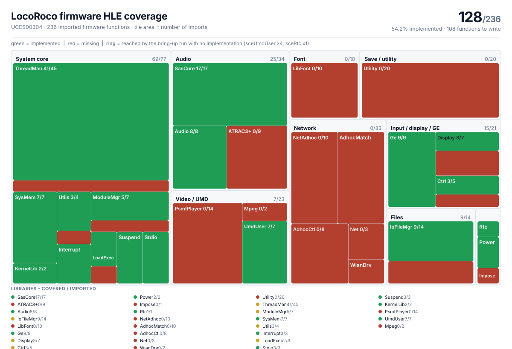

# PSP firmware HLE coverage

How much of the firmware a statically recompiled PSP game actually needs, and how
much of it exists yet. Reference title: **LocoRoco** (UCES00304), brought up with
[sp00nznet/psprecomp](https://github.com/sp00nznet/psprecomp).



A PSP game never touches hardware. It calls firmware entry points through its
import table, and each of those calls is identified by a NID. So "what is still
missing?" is a bounded, countable question: the module imports **236** firmware
functions, and **117** of them are implemented. The picture is that count,
one tile per library, area proportional to the number of imports.

## Reading the picture

| | |
|---|---|
| **green** | implemented |
| **red** | no implementation yet |
| **ring** | the bring-up run *reaches* this function and gets nothing back: it is the next thing to write, not just a gap in a list |

The ring matters because a missing function is not equally costly everywhere. An
unimplemented import returns `0` today, and `0` is a legitimate answer for an
identifier, a size or a pointer, so the game takes a branch it never takes on
hardware and fails far away from the cause. The ring marks the five functions the
run already hits:

| NID | library | function |
|---|---|---|
| `0x6B4A146C` | sceUmdUser | `sceUmdGetDriveStat` |
| `0x8EF08FCE` | sceUmdUser | `sceUmdWaitDriveStat` |
| `0xC6183D47` | sceUmdUser | `sceUmdActivate` |
| `0xAEE7404D` | sceUmdUser | `sceUmdRegisterUMDCallBack` |
| `0x3F7AD767` | sceRtc | `sceRtcGetCurrentTick` |

Read together: the game asks whether a disc is present and spinning, and reads
the clock at start-up. Ordinary PSP start-up code, and the next work item.

## Where the gaps are

| family | covered | total |
|---|---|---|
| System core | 68 | 77 |
| Audio | 25 | 34 |
| Input / display / GE | 15 | 21 |
| Files | 9 | 14 |
| Video / UMD | 0 | 23 |
| Network | 0 | 33 |
| Save / utility (`sceUtility`) | 0 | 20 |
| Font (`sceLibFont`) | 0 | 10 |
| Misc (`sceRtc`, `scePower`, `sceImpose`) | 0 | 4 |

The full list, named, is [docs/progress/hle-missing.md](docs/progress/hle-missing.md).

## How the numbers are produced

Three steps, no game data involved at any point. From a checkout of the toolkit
with its library built:

```sh
# 1. what the toolkit already implements
clang -O0 -I <psprecomp>/include tools/hle_dump.c <psprecomp>/build/libpsprecomp.a -o /tmp/hle_dump
/tmp/hle_dump > hle.txt

# 2. what the module needs  (the C the toolkit emits for its import thunks)
<psprecomp>/build/tools/allegrexrecomp/allegrexrecomp emit <module.elf> /tmp/emit <name>

# 3. cross them, name what is missing, and draw it
python3 tools/hle_coverage.py /tmp/emit/<name>_imports.c hle.txt \
    --pspsdk <pspsdk> --module <name> --outdir .
python3 tools/hle_treemap.py data/<name>-hle-cov.json docs/progress/hle-coverage.svg
```

`--reached` takes the NIDs the run reported as unimplemented, which is what puts
the rings on the picture; `data/*.json` is the snapshot the SVG is drawn from, so
the picture can be regenerated without the game at all.

To update it as work lands: re-run step 3 and commit the new SVG and list.

## What is not here, on purpose

No ROM, no decrypted executable, no disassembly and no generated C: those are
derived from the game and are not redistributed. What is published is a count of
firmware entry points, their NIDs and the names `pspsdk` gives them - public
identifiers of a documented API, not content of the game.

## Credits

- Toolkit: [sp00nznet/psprecomp](https://github.com/sp00nznet/psprecomp) (MIT), which
  reports the import surface and provides the HLE registry these counts read.
- Function names: [pspsdk](https://github.com/pspdev/pspsdk) (BSD-3-Clause).
- The `.sym` symbol maps PPSSPP can export are the other source for names of
  firmware libraries pspsdk does not declare.

Tooling here is MIT (see `LICENSE`).
